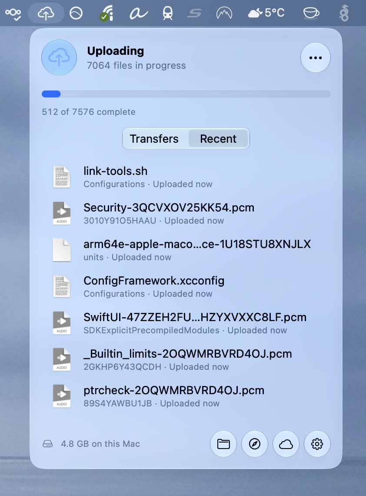

# SyncGlass

[](https://github.com/alberti42/SyncGlass/actions/workflows/verify-release.yml)
[](https://github.com/alberti42/SyncGlass/actions/workflows/build.yml)

**A menu-bar app for macOS that shows which files iCloud Drive is uploading and downloading.**

**[Download SyncGlass.zip](https://github.com/alberti42/SyncGlass/releases/latest/download/SyncGlass.zip)** (latest release, signed and notarized). See [Installation](#installation).

Free and open source (GPL-3.0). Requires macOS 26 or later; runs natively on Apple silicon and Intel Macs.

SyncGlass lists iCloud Drive's transfers in one place: how many files are in flight, each file's percentage, and when each transfer finished.

<p align="left"></p>

---

## Table of Contents

- [Features](#features)
- [Installation](#installation)
- [Permissions and privacy](#permissions-and-privacy)
- [How it works](#how-it-works)
- [Troubleshooting](#troubleshooting)
- [Building from source](#building-from-source)
- [Credits](#credits)
- [License](#license)

---

## Features

- **Menu-bar icon** for each state: up to date, uploading, downloading, syncing changes from other devices, offline. The icon is monochrome, so it follows light mode, dark mode and the menu bar's tint. An optional mode fills the cloud as files finish.
- **Transfers**: the files iCloud is uploading or downloading, each with its percentage and size ("Uploading · 34 % of 209.72 MB").
- **Recent**: the files that finished transferring, newest first, with the time and direction ("Uploaded 3 min ago").
- **File Info**: for any listed file, its iCloud status, live percentage, conflicts, upload and download errors, sharing, the last transfer SyncGlass recorded, and every date macOS keeps for the file.
- **Notifications** when uploads or downloads finish. Short transfers can be left out, and the sound can be chosen.
- **Filters**: include and exclude regular expressions, matched against the full path.
- **Scan for Transfers** finds files that started uploading before SyncGlass was running.
- **Watch for Stuck Files** shows which files iCloud Drive is stuck on. See [Troubleshooting](#troubleshooting).
- **History log** of finished transfers, which opens in Console.
- **Open at login**, through a login helper registered with macOS.
- **Updates** through [Sparkle](https://sparkle-project.org): SyncGlass checks for a new version once a week, or when you choose Check for Updates in the panel's menu.

## Installation

1. Download [`SyncGlass.zip`](https://github.com/alberti42/SyncGlass/releases/latest/download/SyncGlass.zip) from the [latest release](https://github.com/alberti42/SyncGlass/releases/latest).
2. Unzip it and move `SyncGlass.app` to the Applications folder.
3. Open it. On the first launch, choose whether to watch iCloud Drive or all iCloud documents, whether to open SyncGlass at login, and whether to check for updates automatically.

The app is signed with a Developer ID and notarized by Apple. To check where a downloaded ZIP was built:

```sh
gh attestation verify SyncGlass.zip --repo alberti42/SyncGlass
```

## Permissions and privacy

- macOS may ask whether SyncGlass can access iCloud Drive. SyncGlass needs that access to read the iCloud state of your files.
- SyncGlass connects to the network only for updates: it downloads the update feed (`Releases/appcast.xml` in this repository) from GitHub, and, when you install an update, `SyncGlass.zip` from GitHub Releases. Sparkle sends no system profile; the requests carry the names and versions of SyncGlass and Sparkle in the User-Agent header. Turn off "Check for updates automatically" in Settings > General to check only when you choose Check for Updates.
- SyncGlass collects no data.
- Its settings (`~/Library/Preferences/io.alberti42.SyncGlass.plist`), history log and recent-files list (`~/Library/Application Support/io.alberti42.SyncGlass/`) stay on your Mac.

## How it works

SyncGlass uses public macOS APIs, plus one undocumented command while Watch for Stuck Files is on:

- **FSEvents** reports which files change in the watched folder (`~/Library/Mobile Documents`, or only its iCloud Drive part).
- **URL resource values** (`ubiquitousItemIsUploaded`, `ubiquitousItemIsUploading`, `ubiquitousItemIsDownloading`, …) give each file's iCloud state. A file stays in the Transfers list until iCloud reports it uploaded and no longer downloading.
- **`Progress.addSubscriber(forFileURL:)`** receives the progress objects that iCloud Drive publishes for each file it transfers. They carry the byte counts behind the percentages.
- **`brctl status`** (only while Watch for Stuck Files is on) lists the items iCloud Drive has not synced yet, with the time of the last upload attempt. It abbreviates names; SyncGlass identifies each file by its File Provider identifier (`NSFileProviderManager.getIdentifierForUserVisibleFile(at:)`). `brctl` is undocumented, so a macOS update can change its output.

macOS records no date for when a file synced. The times in the Recent list are the moments SyncGlass saw a transfer finish, so they exist only for transfers it watched.

## Troubleshooting

SyncGlass shows iCloud Drive's transfers while they happen. It does not download files that are only in iCloud, and it does not remove local copies. Finder does both: right-click a file and choose **Download Now** or **Remove Download**. To reach a file listed in SyncGlass, click its Show in Finder button or double-click it.

When iCloud Drive seems stuck, choose **Watch for Stuck Files** in the panel's ⋯ menu. SyncGlass then reads iCloud Drive's queue at once and every minute until you turn it off. Files that iCloud has not synced appear in Transfers, also those that started before SyncGlass was running. A file is marked stuck, with a warning symbol and "Waiting · last attempt 4 min ago", when iCloud reports an upload or download error for it, or when it is in iCloud's queue and its upload has not progressed for 2 minutes. Get Info shows the file's entry in the queue and the error. You can turn the watch on after a transfer got stuck: the queue shows its state at the moment SyncGlass reads it.

To print the queue in Terminal:

```sh
/Applications/SyncGlass.app/Contents/MacOS/SyncGlass --queue-status
```

To see what iCloud Drive itself reports, read its log in Terminal. Write the full path `/usr/bin/log`: in zsh, the default shell on macOS, `log` is also the name of a built-in command.

```sh
# the last 10 minutes
/usr/bin/log show --last 10m --style compact --predicate 'process == "bird" OR process == "cloudd" OR subsystem == "com.apple.FileProvider"'

# live, until you press Control-C
/usr/bin/log stream --style compact --predicate 'process == "bird" OR process == "cloudd" OR subsystem == "com.apple.FileProvider"'
```

`bird` is the iCloud Drive daemon; `cloudd` transfers the data to Apple's servers and logs network errors, such as `NSURLErrorDomain -1001` (request timed out); `com.apple.FileProvider` is the macOS framework through which iCloud Drive syncs files. The log does not name the files in full: `bird` writes `<private>` in their place, and FileProvider abbreviates them (`o{10}t.bin` for `offline-test.bin`).

## Building from source

Requires Xcode 26 or later.

```sh
bin/build-app.sh            # build/SyncGlass.app, universal, signed ad hoc
open build/SyncGlass.app
```

`ARCHS=native bin/build-app.sh` builds for this Mac's architecture only. To sign with a Developer ID, set `SIGN_IDENTITY`:

```sh
SIGN_IDENTITY="Developer ID Application: Your Name (TEAMID)" bin/build-app.sh
```

To use your own signing identity, also change the bundle identifiers `io.alberti42.SyncGlass` and `io.alberti42.SyncGlass.LoginHelper` in `Resources/Info.plist`, `Resources/LoginHelper-Info.plist`, `Sources/LoginHelper/main.swift`, `Sources/SyncGlass/LoginItem.swift` and `Sources/SyncGlass/Preferences.swift`. To publish your own updates, set `SUFeedURL` (your appcast) and `SUPublicEDKey` (from Sparkle's `generate_keys`) in `Resources/Info.plist`; otherwise your build offers the updates published in this repository.

## Credits

SyncGlass is inspired by [iCloudStatus](http://www.thealchemistguild.com) by The Alchemist Guild, a no longer maintained app for Intel Macs. SyncGlass is a new app and released as an entirely independent project. The app was created with AI assistance (Claude).

## License

[GNU General Public License v3.0](LICENSE)
